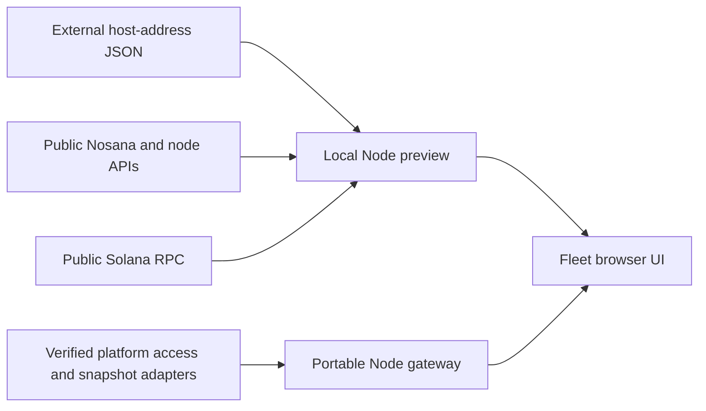

# GridLens

GridLens is a TypeScript monitoring interface for Nosana host operators. Its Fleet
view combines public host metadata, activity, queue position, job duration and
SOL/NOS balances in a compact table designed for fleets of 200+ hosts.

The application, server, build scripts and tests are written in TypeScript;
HTML and CSS provide the page structure and styling. The browser uses plain DOM
APIs. A Node server supplies same-origin data, shared caches and request limits.
The live preview uses public Nosana/node APIs and Solana RPC without wallet keys.

A separate [shared backend candidate](docs/SHARED_BACKEND.md) adds durable SQLite
collection, authenticated HTTPS, browser setup and optional Android pairing.
Its [modern Docker installer](docs/MODERN_INSTALL.md) is separate from the legacy
installer and this developer preview. Isolated Docker acceptance passed on an
authorized Nosana host, including HTTPS, cache sharing and recovery. Development
release **0.1.0-dev.4** provides private-address choices, installer recovery and
direct browser access over an existing LAN/VPN (`--vpn-web`): open the ordinary
dashboard address. The **0.1.0-dev.5** update adds a prominent browser **Search
network** action with progress, cancellation, retry and computer selection. The
installer stays open to handle computer credentials and approved inspection.
Anyone who can reach that private
address has access to its configured fleet. HTTP LAN traffic is unencrypted;
the existing HTTPS endpoint and Android pairing remain available separately.
Physical reboot, GPU recorder lifecycle and physical-phone acceptance remain
separate.

**Country** appears after System at the right edge of Fleet. It reuses the country
reported in existing Nosana metrics, with a saved header toggle between compact
codes and full English names. Missing values remain unknown; this is reported
country, not verified physical location. It adds no API requests or location service.

**Jobs** keeps each Fleet row compact. Expand one host with its arrow, or use the
column's Show all / Hide all controls, to inspect up to ten recent jobs in an
Explorer-style table: Address, Host, Started, Duration, Price, GPU and Status.
Starts use relative time; duration includes the reported maximum. Status badges
keep running, success, failure and unknown results distinct. Exact UTC dates,
lifecycle/result evidence and pricing calculations remain in closed Source details.
History comes directly from Nosana's job API, independently of Explorer's page
layout; Explorer job links are optional. This still depends on Nosana providing
history. Local copies are in memory and can be fetched again after a restart.
Price is calculated customer cost including Explorer's 10% fee, not host rewards
or a settled invoice. Active jobs use a dated market hourly quote; finished jobs
use their recorded rate and final duration. GPU shows the job's market name,
not a physical GPU measurement. Missing rates or names remain unknown. Market
names and current quotes come from a shared, bounded Host Manager JSON API read;
the app does not scrape Explorer pages.
Only expanded Supplied Host Addresses/Real200 histories initiate page reads;
Online GPU Hosts uses already cached records. History shares the existing job
request limits, so a large expansion may remain pending. A five-minute cache
avoids repeated page reads; Refresh remains subject to shared limits and backoff.

**Current status:** the live local preview, portable hosting gateway and shared
backend are implemented. The shared backend passed isolated Docker acceptance;
installer endpoint repair was separately verified on an existing installation
without enabling new fleet monitoring. Per-operator beta links and CSV uploads
remain proposals. Some columns remain unknown until verified sources are connected.

## Run the live preview

Use **Node 24.14.1** and **npm 11.11.0**, pinned in `.nvmrc` and `package.json`.
If you use nvm, run `nvm use` from the checkout.

```sh
git clone https://github.com/MachoDrone/gridlens-typescript.git
cd gridlens-typescript
npm ci --ignore-scripts
```

Prepare a JSON file **outside the checkout** containing your own public host
addresses: a JSON array of unique base58 strings, each decoding to 32 bytes.
An empty array (`[]`) is valid. To use a CSV export, extract only its `Node Address`
column into this array with a CSV-aware tool; omit contacts, measurements and all
other fields. The app reads JSON and has no CSV importer.

```sh
GRIDLENS_HOSTS_FILE=/absolute/path/to/hosts.json npm run dev
```

Open **[http://127.0.0.1:4173](http://127.0.0.1:4173)**. Each supplied address becomes
one row. Missing or invalid input produces an explicit error; the app does not
create, repair or replace the file. Files are read once at startup, so restart
after changing them. The server also needs a restart after source edits; then
reload the browser. There is no hot reload.

**Real200** is an optional second live roster, independent of the first list:

```sh
GRIDLENS_HOSTS_FILE=/absolute/path/to/hosts.json \
GRIDLENS_REAL200_HOSTS_FILE=/absolute/path/to/real200.json \
npm run dev
```

Select **Scenario → Real200**, or open
[http://127.0.0.1:4173/?scenario=real200](http://127.0.0.1:4173/?scenario=real200).
The name does not require 200 addresses; the table shows the actual count.
Only the selected live roster is requested. Both lists and all viewers share
upstream caches and request budgets within that server process.

**Online GPU Hosts** is an automatically maintained live scenario. Select it in
Scenario, or open
[Online GPU Hosts](http://127.0.0.1:4173/?scenario=online-gpu-hosts).
The preview reads the public Nosana indexer's complete queued-host and
running-host lists as candidates, without API keys or wallet access. Candidate
membership refreshes every minute while viewed and rechecks when reopened.
The table shows only candidates with a current, successful **API Online** check
(the existing 30-second proof window). Offline, unconfirmed and expired results
stay outside the table; their bounded checks continue so recovered hosts can
reappear automatically. The host count reflects the confirmed subset, and the
notice below Scenario also shows the candidate count. Address changes require no file
preparation, rebuild or restart. The existing two host files remain independent.

Explorer's queued-or-running total can include abandoned hosts with old job
records still marked running. Matching that total alone does not establish current
reachability. The additional API check confirms a response, not physical GPU health
or job activity; job age alone never controls inclusion or warning colors.
A discovery failure retains the candidate list with its original check time and
a visible stale notice; current API evidence still controls displayed rows. The full
Fleet table uses the existing shared request budgets: network-wide lists can
leave many readings pending or stale, and simultaneous live views share capacity.
No discovery runs while this scenario has no viewers, and its roster stays in
memory. These public indexer reads are best effort, not a heartbeat guarantee.
Filtering affects presentation. Duration uses only job timings already cached by
Supplied Host Addresses or Real200; Online GPU Hosts starts no new job discovery
or timing-maintenance requests. This protects the existing fleets' job-request
capacity. Uncached timings remain unknown, and cached readings retain their
original check times and expiry. Other shared readers still check the candidate
roster and preserve per-host observations and retry history.

See [development guidance](docs/DEVELOPMENT.md) for default input paths, source
semantics, saved controls, detached startup and the current backlog. Live rosters
and CSV exports belong outside Git and build artifacts.

## Preview without live data

```sh
npm run dev:handoff
```

Open **[http://127.0.0.1:4175](http://127.0.0.1:4175)**. This separately labeled
rehearsal uses synthetic snapshots with the same UI and portable gateway. It
requires no host files and makes no public-provider requests. Its access resolver
is a local demonstration, not production authentication.

The live preview's **Scenario** selector also includes isolated synthetic examples
for fresh, stale, failed, missing and 200-host views. Synthetic readings never
enter live rosters or stores.

## Architecture and review guide



The two server compositions share the UI and typed observation contracts. The
portable gateway requires explicit access and snapshot adapters; it does not
fall back to the preview's public readers.

| Path | Responsibility |
| --- | --- |
| [`src/preview/`](src/preview/) | Browser UI, rendering, interactions and same-origin transport. |
| [`src/fleet/`](src/fleet/) | Pure domain projections, sorting and freshness rules. |
| [`src/contracts/`](src/contracts/) | Typed roster and observation contracts. |
| [`scripts/preview-server.ts`](scripts/preview-server.ts) and [`scripts/`](scripts/) | Local live server, bounded public-data adapters and build tooling. |
| [`src/server/`](src/server/) | Authorized gateway, snapshot source/store and local persistence reference. |
| [`test/`](test/) | Isolated Node and browser checks. |
| [`docs/HOSTING_HANDOFF.md`](docs/HOSTING_HANDOFF.md) | Runtime artifact, adapter contracts and pending platform decisions. |
| [`docs/UX_CONSISTENCY.md`](docs/UX_CONSISTENCY.md) | Phone/laptop behavior and acceptance requirements. |

Online discovery belongs only to the local preview; the portable gateway still
requires its explicitly authorized roster and snapshot adapters.

The preview binds to loopback and is developer tooling, not a public beta service.
A static host such as GitHub Pages cannot run its Node data server. The portable
gateway supplies an integration boundary for eventual hosting; actual hosting
and backend arrangements remain open.

## Verify and build

```sh
npx --no-install playwright install chromium
npm run check
npm run build:handoff
```

`check` runs strict typechecking, Node tests, the browser build and Playwright
checks. Automated checks use injected providers, synthetic fixtures and loopback
servers; they do not query real hosts or public providers.

`npm run build` emits browser assets in ignored `dist/`. `build:handoff` emits a
compiled Node gateway, the same browser assets, typed adapter declarations, a
runtime guide and an integrity manifest in ignored `.tools/handoff/`. The artifact
requires a real integration module before it can serve production data. See the
[hosting handoff](docs/HOSTING_HANDOFF.md) for usage and acceptance boundaries.

## License

[MIT](LICENSE), Copyright (c) 2026 MachoDrone. Preserve this notice and applicable
third-party notices when redistributing the code.
