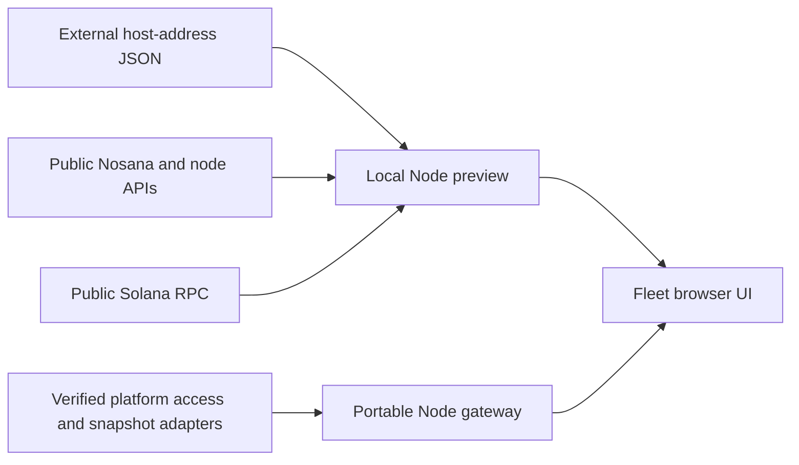

# GridLens

GridLens is a TypeScript monitoring interface for Nosana host operators. Its Fleet
view combines public host metadata, activity, queue position, job duration and
SOL/NOS balances in a compact table designed for fleets of 200+ hosts.

The application, server, build scripts and tests are written in TypeScript;
HTML and CSS provide the page structure and styling. The browser uses plain DOM
APIs. A Node server supplies same-origin data, shared caches and request limits.
The live preview uses public Nosana/node APIs and Solana RPC without wallet keys.

The [Wallet pilot candidate](docs/WALLET_PILOT.md) adds a separate password-protected
owner and one receiving public wallet address. Setup and financial actions require
the saved HTTPS connection. The first milestone permits one reviewed **1 NOS total**
transfer from one host, verifies its receipt, then stops. The separate rewards
pilot claims **all available uptime rewards** for one reviewed host into that
host's wallet, with a persistent verified receipt and no forwarding. One unresolved
claim blocks further claims; after confirmation a different host can be tested.
Compatibility-first installer/updater rollout is required; source
implementation does not establish publication, live enablement or a transfer.

Wallet also offers local **Forgot password?** recovery after the owner saves six
questions. Choose from twelve editable prompts or write custom questions; recovery
requires three selected questions, with persistent guessing limits. This needs no
email service or recovery file. It preserves the original owner identity and
financial history, and requires that installation's saved data to remain intact.

A separate [shared backend candidate](docs/SHARED_BACKEND.md) adds durable SQLite
collection, authenticated HTTPS, browser PC management and optional Android pairing.
Its [modern Docker installer](docs/MODERN_INSTALL.md) is separate from the legacy
installer and this developer preview. Isolated Docker acceptance passed on an
authorized Nosana host, including HTTPS, cache sharing and recovery. Development
release **0.1.0-dev.4** provides private-address choices, installer recovery and
direct browser access over an existing LAN/VPN (`--vpn-web`): open the ordinary
dashboard address. The **0.1.0-dev.8** update keeps installation short and explains
what the PC address and web port mean, how to accept their defaults, and what to
do next. The CLI retains meaningful colors and spacing.
The left-menu **Hosts** action opens browser PC management, leading from search results to computer selection,
**Add Selected PCs** below the list, and sign-in using a password or SSH private-key
file. Rewards/GPU monitoring is checked by default and can be turned off before
submitting setup. Results clearly lead to the primary **Open Fleet** action.
Saved sign-ins can be reused or updated; computers can be removed or explicitly
restored. When a fleet is already configured, **View Fleet** appears before the
computer list and adding or changing computers is optional. Connected viewers
and returning operators with a current populated roster go from the connection
page directly to Fleet; **Hosts** still opens computer management.
Selecting monitoring options alone changes no permissions until setup
is submitted. Anyone who can reach that private address has access to its configured
fleet. HTTP LAN traffic is unencrypted;
that includes submitted passwords, SSH private keys, passphrases and optional
administrator passwords on the LAN leg. Credentials are retained encrypted only
by the backend owner. The existing HTTPS endpoint and
Android pairing remain available separately.
Physical reboot, GPU recorder lifecycle and physical-phone acceptance remain
separate.

**Secure** in the left sidebar opens the optional guided local HTTPS setup; its
lock icon remains visible when the menu is collapsed. It supplies the existing public certificate
directly to the device, guides Windows/macOS/Linux/Android and iPhone/iPad approval, then
checks the saved HTTPS address and connects the browser using a one-use handoff
from its existing private-network access. Normal setup needs no extra CLI command
or manually copied connection code. Initial HTTP
enrollment assumes a trusted private network; it does not authenticate the
certificate against an active attacker on that network. No domain or hosted
service is needed. Ordinary HTTP access and existing paired clients remain intact.
The new browser connection stays tied to the private-network grant and stops
working if it is revoked; it grants no Wallet ownership.
The guide uses the detected device/browser by default, with optional Change
controls. Samsung phones use Android instructions. After import, **I've imported
it — Open GridLens** checks the saved HTTPS identity and browser access and opens
Fleet directly; normal signed-out HTTPS bookmarks resume the guide instead of a
manual connection-code screen.
On iPhone/iPad, Safari downloads a certificate-only Apple profile containing the
existing public CA. Installing the profile and enabling full website trust in
Settings are separate actions. Mac instructions use Keychain Access and SSL trust;
they are not the iPhone/iPad procedure. These instructions follow primary vendor
documentation; physical Apple profile import and trust verification remain separate.
See [guided secure browser setup](docs/SECURE_BROWSER_SETUP.md) for platform
instructions, limitations and verification coverage.

Standard web-app metadata and icons remain an **optional capability for trusted
HTTPS**. **Install GridLens** appears only when the browser offers installation;
installing the web app and trusting the local certificate are different steps.
Domain provisioning, public exposure, automatic certificate renewal and native
pin rotation are not part of this guide. See
[installation and deployment boundaries](docs/HOSTING_HANDOFF.md#local-web-app-installation).

The dev.9 display update keeps Hosts inside the existing sidebar width, including
its icon-only collapsed state. IP display follows Android's six views: hidden,
both full addresses, public full, public last octet, private full, private last
octet. Changing it redraws only IP cells and starts no requests. Compact Jobs cells
show the job link and expansion control; lifecycle and observation times remain
in accessible labels and expanded details.

The browser-update candidate adds **Update** below Hosts without widening the
sidebar. Its icon pulses green for a verified newer release, or stays green with
reduced motion. **Update now** downloads, verifies and installs the development
release for this GridLens installation. Progress survives dashboard restarts and
browser closure; the browser returns to Fleet after the installed build and its
data path verify. Unknown or stale host readings do not delay readiness. This
requires the separate updater provisioned by the modern installer; existing
installations need a maintainer-handled enabling migration first. This source
feature is not evidence of publication or live enablement. See
[browser updates](docs/MODERN_INSTALL.md#browser-controlled-updates).

Normal dashboard updates require no Wallet setup or password. The installation's
approved private dashboard and its HTTPS browser connection can install signed
updates while Wallet actions remain separately protected. Monitoring-only viewer
installations can inspect update status but cannot start an update.

**Country** appears after System at the right edge of Fleet. It reuses the country
reported in existing Nosana metrics, with a saved header toggle between compact
codes and full English names. Missing values remain unknown; this is reported
country, not verified physical location. It adds no API requests or location service.

**Job Address** defaults to a five-character link. Its saved header toggle shows
the full address without changing history, sorting or requests. Expand one host
with its arrow, or use the
column's Show all / Hide all controls, to inspect up to ten recent jobs in an
Explorer-style table: Address, Host, Started, Duration, Price, GPU and Status.
Starts use relative time; duration includes the reported maximum. Status badges
keep running, success, failure and unknown results distinct. Exact UTC dates,
lifecycle/result evidence and pricing calculations remain in closed Source details.
History comes directly from Nosana's job API, independently of Explorer's page
layout; Explorer job links are optional. This still depends on Nosana providing
history. Local copies are in memory and can be fetched again after a restart.
Price is calculated customer cost including Explorer's 10% fee, not host rewards
or a settled invoice. Active jobs use a dated market hourly quote; finished jobs
use their recorded rate and final duration. GPU shows the job's market name,
not a physical GPU measurement. Missing rates or names remain unknown. Market
names and current quotes come from a shared, bounded Host Manager JSON API read;
the app does not scrape Explorer pages.
Only expanded Supplied Host Addresses/Real200 histories initiate page reads;
Online GPU Hosts uses already cached records. History shares the existing job
request limits, so a large expansion may remain pending. A five-minute cache
avoids repeated page reads; Refresh remains subject to shared limits and backoff.

Protected-runtime candidates add [owner-bound finance and staff viewers](docs/OWNER_BOUND_FINANCE.md).
Wallet enrollment pins the owner's authority on each source PC; another
installation's password grants no access to enrolled sources. Staff viewers get
read-only fleet data and no source credentials. Source administrators remain trusted.

**GPU ID** joins each host's verified GPU UUIDs to physical PC indices. Multiple
GPUs are listed together; unavailable or stale mappings remain explicit. A compact
warning separates failed GPU reads from recorded kernel faults. An Xid 79 warning
requires matching kernel evidence and retains its event time; a successful driver
version read is not evidence that a GPU recovered.

For approved PCs, CUDA/NVIDIA can use dated `nvidia-smi --version` readings when
Nosana reports an unavailable value. One PC read serves its associated hosts;
the display retains source/time and stale styling. CUDA means driver-supported
CUDA, and a successful version read does not establish GPU health.

**Current status:** the live local preview, portable hosting gateway and shared
backend are implemented. The shared backend passed isolated Docker acceptance;
installer endpoint repair was separately verified on an existing installation
without enabling new fleet monitoring. Per-operator beta links and CSV uploads
remain proposals. Some columns remain unknown until verified sources are connected.

## Run the live preview

Use **Node 24.14.1** and **npm 11.11.0**, pinned in `.nvmrc` and `package.json`.
If you use nvm, run `nvm use` from the checkout.

```sh
git clone https://github.com/MachoDrone/gridlens-typescript.git
cd gridlens-typescript
npm ci --ignore-scripts
```

Prepare a JSON file **outside the checkout** containing your own public host
addresses: a JSON array of unique base58 strings, each decoding to 32 bytes.
An empty array (`[]`) is valid. To use a CSV export, extract only its `Node Address`
column into this array with a CSV-aware tool; omit contacts, measurements and all
other fields. The app reads JSON and has no CSV importer.

```sh
GRIDLENS_HOSTS_FILE=/absolute/path/to/hosts.json npm run dev
```

Open **[http://127.0.0.1:4173](http://127.0.0.1:4173)**. Each supplied address becomes
one row. Missing or invalid input produces an explicit error; the app does not
create, repair or replace the file. Files are read once at startup, so restart
after changing them. The server also needs a restart after source edits; then
reload the browser. There is no hot reload.

**Real200** is an optional second live roster, independent of the first list:

```sh
GRIDLENS_HOSTS_FILE=/absolute/path/to/hosts.json \
GRIDLENS_REAL200_HOSTS_FILE=/absolute/path/to/real200.json \
npm run dev
```

Select **Real200** in the preview data selector, or open
[http://127.0.0.1:4173/?scenario=real200](http://127.0.0.1:4173/?scenario=real200).
The name does not require 200 addresses; the table shows the actual count.
Only the selected live roster is requested. Both lists and all viewers share
upstream caches and request budgets within that server process.

**Online GPU Hosts** is an automatically maintained live scenario. Select it in
the preview data selector, or open
[Online GPU Hosts](http://127.0.0.1:4173/?scenario=online-gpu-hosts).
The preview reads the public Nosana indexer's complete queued-host and
running-host lists as candidates, without API keys or wallet access. Candidate
membership refreshes every minute while viewed and rechecks when reopened.
The table shows only candidates with a current, successful **API Online** check
(the existing 30-second proof window). Offline, unconfirmed and expired results
stay outside the table; their bounded checks continue so recovered hosts can
reappear automatically. The host count reflects the confirmed subset, and the
notice below the preview data selector also shows the candidate count. Address changes require no file
preparation, rebuild or restart. The existing two host files remain independent.

Explorer's queued-or-running total can include abandoned hosts with old job
records still marked running. Matching that total alone does not establish current
reachability. The additional API check confirms a response, not physical GPU health
or job activity; job age alone never controls inclusion or warning colors.
A discovery failure retains the candidate list with its original check time and
a visible stale notice; current API evidence still controls displayed rows. The full
Fleet table uses the existing shared request budgets: network-wide lists can
leave many readings pending or stale, and simultaneous live views share capacity.
No discovery runs while this scenario has no viewers, and its roster stays in
memory. These public indexer reads are best effort, not a heartbeat guarantee.
Filtering affects presentation. Duration uses only job timings already cached by
Supplied Host Addresses or Real200; Online GPU Hosts starts no new job discovery
or timing-maintenance requests. This protects the existing fleets' job-request
capacity. Uncached timings remain unknown, and cached readings retain their
original check times and expiry. Other shared readers still check the candidate
roster and preserve per-host observations and retry history.

See [development guidance](docs/DEVELOPMENT.md) for default input paths, source
semantics, saved controls, detached startup and the current backlog. Live rosters
and CSV exports belong outside Git and build artifacts.

## Preview without live data

```sh
npm run dev:handoff
```

Open **[http://127.0.0.1:4175](http://127.0.0.1:4175)**. This separately labeled
rehearsal uses synthetic snapshots with the same UI and portable gateway. It
requires no host files and makes no public-provider requests. Its access resolver
is a local demonstration, not production authentication.

The live preview's data selector also includes isolated synthetic examples
for fresh, stale, failed, missing and 200-host views. Synthetic readings never
enter live rosters or stores.

## Architecture and review guide



The two server compositions share the UI and typed observation contracts. The
portable gateway requires explicit access and snapshot adapters; it does not
fall back to the preview's public readers.

| Path | Responsibility |
| --- | --- |
| [`src/preview/`](src/preview/) | Browser UI, rendering, interactions and same-origin transport. |
| [`src/fleet/`](src/fleet/) | Pure domain projections, sorting and freshness rules. |
| [`src/contracts/`](src/contracts/) | Typed roster and observation contracts. |
| [`scripts/preview-server.ts`](scripts/preview-server.ts) and [`scripts/`](scripts/) | Local live server, bounded public-data adapters and build tooling. |
| [`src/server/`](src/server/) | Authorized gateway, snapshot source/store and local persistence reference. |
| [`test/`](test/) | Isolated Node and browser checks. |
| [`docs/HOSTING_HANDOFF.md`](docs/HOSTING_HANDOFF.md) | Runtime artifact, adapter contracts and pending platform decisions. |
| [`docs/UX_CONSISTENCY.md`](docs/UX_CONSISTENCY.md) | Phone/laptop behavior and acceptance requirements. |

Online discovery belongs only to the local preview; the portable gateway still
requires its explicitly authorized roster and snapshot adapters.

The preview binds to loopback and is developer tooling, not a public beta service.
A static host such as GitHub Pages cannot run its Node data server. The portable
gateway supplies an integration boundary for eventual hosting; actual hosting
and backend arrangements remain open.

## Verify and build

```sh
npx --no-install playwright install chromium
npm run verify -- --base "$(git rev-parse origin/main)"
npm run check
npm run build:handoff
```

`verify` selects and explains the checks needed for changes since the supplied
immutable baseline; unknown or broad impact selects full coverage. Financial,
authorization and persistence safety checks remain mandatory for their changes.
`check` runs the full strict typechecking, single browser build, Node and Playwright
gate. Automated checks use injected providers, synthetic fixtures and loopback
servers; they do not query real hosts or public providers.

Approved development publication uses the maintained, resumable `npm run release`
workflow; see [release operation and recovery](docs/RELEASE_WORKFLOW.md). Runtime
downloads are gzip-compressed with legacy-compatible `.tar` names, and unchanged
signed coordinator binaries can be reused from their immutable release. These
reduce transfer size; they do not change Wallet behavior or install an update
without a separate operator action.

`npm run build` emits browser assets in ignored `dist/`. `build:handoff` emits a
compiled Node gateway, the same browser assets, typed adapter declarations, a
runtime guide and an integrity manifest in ignored `.tools/handoff/`. The artifact
requires a real integration module before it can serve production data. See the
[hosting handoff](docs/HOSTING_HANDOFF.md) for usage and acceptance boundaries.

## License

[MIT](LICENSE), Copyright (c) 2026 MachoDrone. Preserve this notice and applicable
third-party notices when redistributing the code.
