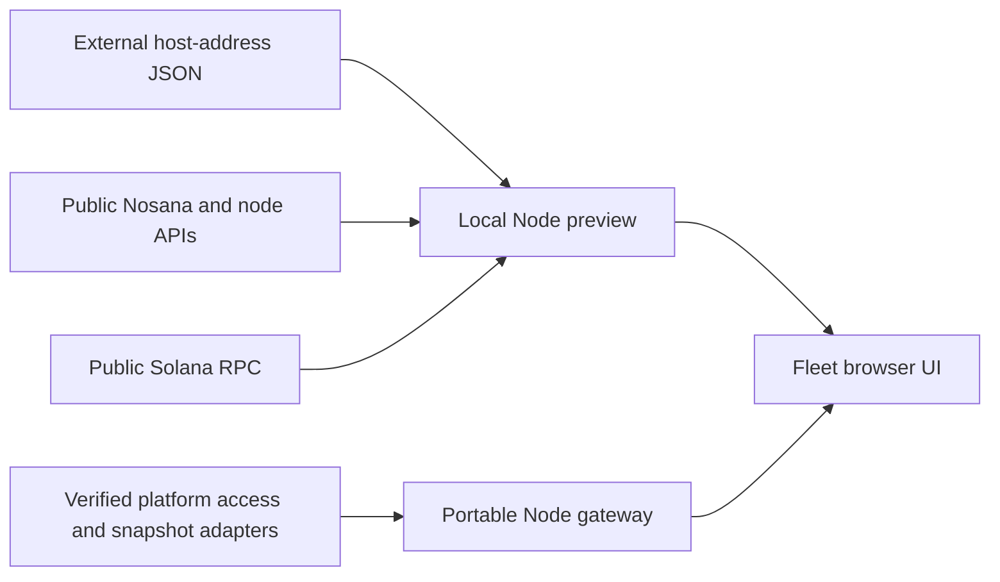

# GridLens

GridLens is a TypeScript monitoring interface for Nosana host operators. Its Fleet
view combines public host metadata, activity, queue position, job duration and
SOL/NOS balances in a compact table designed for fleets of 200+ hosts.

The application, server, build scripts and tests are written in TypeScript;
HTML and CSS provide the page structure and styling. The browser uses plain DOM
APIs. A Node server supplies same-origin data, shared caches and request limits.
The live preview uses public Nosana/node APIs and Solana RPC without wallet keys.

**Current status:** the live local preview and a separate portable hosting gateway
are implemented. Hosting, production access control and backend integrations are
not deployed. Per-operator beta links and CSV uploads are proposals, not features
in this revision. Some columns remain unknown until verified sources are connected.

## Run the live preview

Use **Node 24.14.1** and **npm 11.11.0**, pinned in `.nvmrc` and `package.json`.
If you use nvm, run `nvm use` from the checkout.

```sh
git clone https://github.com/MachoDrone/gridlens-typescript.git
cd gridlens-typescript
npm ci --ignore-scripts
```

Prepare a JSON file **outside the checkout** containing your own public host
addresses: a JSON array of unique base58 strings, each decoding to 32 bytes.
An empty array (`[]`) is valid. To use a CSV export, extract only its `Node Address`
column into this array with a CSV-aware tool; omit contacts, measurements and all
other fields. The app reads JSON and has no CSV importer.

```sh
GRIDLENS_HOSTS_FILE=/absolute/path/to/hosts.json npm run dev
```

Open **[http://127.0.0.1:4173](http://127.0.0.1:4173)**. Each supplied address becomes
one row. Missing or invalid input produces an explicit error; the app does not
create, repair or replace the file. Files are read once at startup, so restart
after changing them. The server also needs a restart after source edits; then
reload the browser. There is no hot reload.

**Real200** is an optional second live roster, independent of the first list:

```sh
GRIDLENS_HOSTS_FILE=/absolute/path/to/hosts.json \
GRIDLENS_REAL200_HOSTS_FILE=/absolute/path/to/real200.json \
npm run dev
```

Select **Scenario → Real200**, or open
[http://127.0.0.1:4173/?scenario=real200](http://127.0.0.1:4173/?scenario=real200).
The name does not require 200 addresses; the table shows the actual count.
Only the selected live roster is requested. Both lists and all viewers share
upstream caches and request budgets within that server process.

See [development guidance](docs/DEVELOPMENT.md) for default input paths, source
semantics, saved controls, detached startup and the current backlog. Live rosters
and CSV exports belong outside Git and build artifacts.

## Preview without live data

```sh
npm run dev:handoff
```

Open **[http://127.0.0.1:4175](http://127.0.0.1:4175)**. This separately labeled
rehearsal uses synthetic snapshots with the same UI and portable gateway. It
requires no host files and makes no public-provider requests. Its access resolver
is a local demonstration, not production authentication.

The live preview's **Scenario** selector also includes isolated synthetic examples
for fresh, stale, failed, missing and 200-host views. Synthetic readings never
enter live rosters or stores.

## Architecture and review guide



The two server compositions share the UI and typed observation contracts. The
portable gateway requires explicit access and snapshot adapters; it does not
fall back to the preview's public readers.

| Path | Responsibility |
| --- | --- |
| [`src/preview/`](src/preview/) | Browser UI, rendering, interactions and same-origin transport. |
| [`src/fleet/`](src/fleet/) | Pure domain projections, sorting and freshness rules. |
| [`src/contracts/`](src/contracts/) | Typed roster and observation contracts. |
| [`scripts/preview-server.ts`](scripts/preview-server.ts) and [`scripts/`](scripts/) | Local live server, bounded public-data adapters and build tooling. |
| [`src/server/`](src/server/) | Authorized gateway, snapshot source/store and local persistence reference. |
| [`test/`](test/) | Isolated Node and browser checks. |
| [`docs/HOSTING_HANDOFF.md`](docs/HOSTING_HANDOFF.md) | Runtime artifact, adapter contracts and pending platform decisions. |
| [`docs/UX_CONSISTENCY.md`](docs/UX_CONSISTENCY.md) | Phone/laptop behavior and acceptance requirements. |

The preview binds to loopback and is developer tooling, not a public beta service.
A static host such as GitHub Pages cannot run its Node data server. The portable
gateway supplies an integration boundary for eventual hosting; actual hosting
and backend arrangements remain open.

## Verify and build

```sh
npx --no-install playwright install chromium
npm run check
npm run build:handoff
```

`check` runs strict typechecking, Node tests, the browser build and Playwright
checks. Automated checks use injected providers, synthetic fixtures and loopback
servers; they do not query real hosts or public providers.

`npm run build` emits browser assets in ignored `dist/`. `build:handoff` emits a
compiled Node gateway, the same browser assets, typed adapter declarations, a
runtime guide and an integrity manifest in ignored `.tools/handoff/`. The artifact
requires a real integration module before it can serve production data. See the
[hosting handoff](docs/HOSTING_HANDOFF.md) for usage and acceptance boundaries.

## License

[MIT](LICENSE), Copyright (c) 2026 MachoDrone. Preserve this notice and applicable
third-party notices when redistributing the code.
