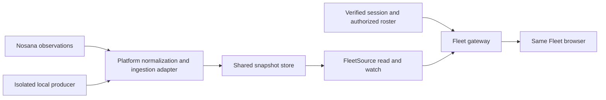

# GridLens hosting handoff

The local preview uses the same browser and observation contracts as the portable
hosting runtime.

The [shared backend candidate](SHARED_BACKEND.md) now supplies an optional
installed composition using these contracts: SQLite collection owner, restricted
IPC, authenticated HTTPS and device pairing. It has its own
[modern Docker installer](MODERN_INSTALL.md). The portable artifact described
here still requires explicit integration and has no default provider fallback.
Neither source implementation establishes a production deployment.
The development public-provider adapters and the portable snapshot gateway are
separate compositions of that application. Moving the supported fields should
require platform adapters and configuration, not edits throughout the Fleet table.

Hosting is not arranged. The gateway below is a working Node reference
implementation with an injected access resolver and snapshot source. A real
platform session, data connector, production store and deployment configuration
still need to be supplied and verified. Public source availability does not
provide a running service or connect currently unavailable fields.

## What is implemented locally

| Boundary | Implementation |
| --- | --- |
| Browser/domain | The same compiled Fleet UI, pure field projections, original timestamps, retained/unknown values, sorting and preferences. |
| Browser transport | Trusted same-origin resource prefix, shared roster/record/envelope validation, bounded JSON/NDJSON, complete-response and watch-idle deadlines, cancellation and access-denied errors. |
| Platform access | Required injected resolver returns an authorized scope and immutable roster revision. There is no default login, token format, proxy-header identity or public provider fallback. |
| Snapshot source | Typed read/watch port for eight resource families, including recent job history; the reference source only reads committed bulk snapshots. Requests do not trigger host discovery or collection. |
| Snapshot storage | Scope/roster isolation, atomic validated resource updates, compare-and-swap revisions, old-evidence rejection, field allowlisting and subscriptions. |
| Local persistence | Explicit single-writer file adapter, exclusive lifetime lock, bounded validated restore, atomic replacement and durability flushes. Source timestamps survive restart. |
| Runtime | Explicit bind/port/origin/module configuration, Host/Origin checks, bounded responses, readiness/liveness, stream cancellation and graceful shutdown. |
| Handoff artifact | Reproducible compiled JavaScript and declarations, browser assets, package/lock, this guide, MIT license, configuration example and SHA-256 manifest. |



The normal live preview at `http://127.0.0.1:4173` retains its existing explicit
startup address files and anonymous public readers. Those provider constructors,
local files and their process-local quotas are not the hosted runtime's fallback.
Snapshot mode labels its source and ignores synthetic scenario query
parameters. The optional browser fixture module stays in the shared browser build;
it cannot select sample rows in snapshot mode or enter the snapshot store.

## Run the integration rehearsal locally

Use the pinned Node 24.14.1/npm 11.11.0 toolchain and the repository's installed
development dependencies:

```sh
npm run dev:handoff
```

Open `http://127.0.0.1:4175`. This is an explicitly labeled, loopback-only hosting
simulation with eight synthetic hosts. It makes no public-provider requests and
never reads either real Host Address file. It exercises the actual snapshot
gateway and the same UI. It does not simulate a real Nosana login.
If a local rehearsal is already running, reuse it while healthy. Before stopping
it, verify its command, working directory and process group; terminate only that
owned process group gracefully. Never kill a process merely because it occupies
port 4175.

To exercise stale data after three days, launch a fresh in-memory rehearsal:

```sh
GRIDLENS_LAB_AGE_SECONDS=259200 npm run dev:handoff
```

The retained API result remains regular-weight and its original date is retained;
Duration is a dimmed estimate. Reopening or reloading does not renew those dates.
The wording and artwork remain the established UI contract: a retained Online or
Offline label is historical, not current endpoint proof. The details explicitly
state Last confirmed/Last known. This is not a guarantee that provider observations
are intrinsically correct or synchronized.

To exercise persistence, explicitly select a new empty lab directory:

```sh
GRIDLENS_LAB_STORE=/tmp/gridlens-hosting-rehearsal npm run dev:handoff
```

Stop with Ctrl+C, run the same command again and inspect the original check times.
The demo only seeds a missing snapshot; restart never recreates an existing
snapshot with today's time. It generates no synthetic refreshes after seeding,
so readings age naturally. Tests separately commit new data while no viewer is open. A nonempty unmarked directory is rejected. Keep the
lab directory separate from live state. No browser writes, host discovery or
address-file maintenance are introduced.

The file adapter supports **one writer process**. A second owner is rejected;
a crashed owner's lock is not automatically removed. Investigate the previous
owner before removing a stale lab lock. An ambiguous storage/flush failure stops
reads, writes and watches until close/reopen validates the committed file. This
is a local durability reference, not a distributed database or lease algorithm.
Two gateway tests share one store owner; they do not establish multi-process
writer safety or production failover.

## Build and inspect the handoff

```sh
npm run check
npm run build:handoff
```

The explicit build writes `.tools/handoff/` (ignored by Git). It replaces only an
existing generated directory with its ownership manifest; an arbitrary directory
or the repository cannot be overwritten. An alternate output can be supplied:

```sh
npm run build:handoff -- --output /tmp/gridlens-handoff
```

The artifact needs the supported Node runtime; it has no third-party runtime
package dependencies. Optional `npm ci --omit=dev --ignore-scripts` verifies its
included production lock. The manifest records the pinned build toolchain and
hash/size of each payload file, including this guide. Repeated builds of unchanged
inputs are byte-identical. The manifest provides integrity information; it is not
a signed release or an authenticity assertion.

The artifact contains no implementation TypeScript, test fixtures, address files,
provider collectors, node_modules, snapshot data, credentials or local evidence.
Declaration files expose the typed adapter boundaries. It has explicit package
subpaths `./application`, `./contracts`, `./snapshot-source`, `./snapshot-store`
and `./file-snapshot-store`; no implicit root/default adapter is selected.

A trusted integration module outside the artifact exports:

```ts
export async function createIntegration(): Promise<FleetIntegration>
```

It is loaded only from an operator-configured filesystem path. Module import or
initialization failure stops startup with a bounded error. No `.env` file or
remote module URL is discovered automatically.

`GRIDLENS_BASE_PATH` defaults to the root. Set it to a path such as `/tools/fleet`
to serve assets, data and health endpoints below an existing site. The gateway
configures the unchanged browser automatically; `GRIDLENS_PUBLIC_ORIGIN` remains
the origin alone. Use the mounted paths and configured Host for health probes.

```sh
GRIDLENS_INTEGRATION_MODULE=/absolute/path/to/platform-integration.mjs \
GRIDLENS_HOST=127.0.0.1 \
GRIDLENS_PORT=4173 \
GRIDLENS_PUBLIC_ORIGIN=http://127.0.0.1:4173 \
GRIDLENS_BASE_PATH= \
npm start
```

This command is for the artifact directory after a real integration module has
been supplied. It deliberately fails closed when that module is missing; the
local simulation module is not shipped in the hosted artifact. Binding beyond
loopback requires an explicit public HTTP(S) origin. No OS package/service,
network, DNS or firewall changes are performed by this launcher.

## Integration contract

`FleetIntegration` supplies:

- `resolveAccess(request, signal?)`: verify the platform session and return either
  `null` or `{ scopeId, rosterRevision, addresses }`. Only these declared fields
  reach the data source. Determine scope and membership from trusted platform
  state, not a browser address list or arbitrary forwarded identity headers.
- `source`: the `FleetSource` implementation. The provided `createSnapshotSource`
  wraps the chosen snapshot store; an integration may instead read the platform's
  already-maintained normalized bulk data using the same contract.
- Optional `close()`: release owned integration resources during graceful shutdown.
- Optional `label`: short plain text identifying the configured data source.
- Optional `demonstration`: the local rehearsal sets this explicitly to display a
  visible synthetic-data notice; production sources do not set it.

The module is trusted server code. Credential handling belongs to the verified
platform integration; credentials, raw sessions, source payloads and extra fields
are not part of the wire/store contract. Do not invent a wallet signature, OAuth
flow or API-key setup. The local test resolver is a fixture, not production auth.

`FleetSource.read(resource, context, signal, onUpdate?)` returns a finite snapshot.
An optional `watch(resource, context, signal, onUpdate)` supports live metadata,
Node Info and Queue feeds. Other resources retain their finite check cadence.
Progress may contain a subset of the authorized roster; final snapshots must
contain it exactly once. All source data is normalized before it reaches HTTP.
Unknown fields are stripped, identities and deadlines validated, exceptions
sanitized, and malformed/oversized responses fail closed. A failed initial
authorized-roster read can be retried with Refresh view without reloading.
Successful rosters remain fixed for that page; there is no automatic roster polling.

The resource families are `metadata`, `node-info`, `jobs`, `job-history`, `queue`,
`sol`, `nos` and `staking`. Their existing field types, null meanings, exact integer amounts,
source identities and date semantics are exported by `./contracts`. Source check
times are not gateway response times or indexer synchronization watermarks.
A cache read, heartbeat, login, reload or restart must never refresh them.

Metadata optionally carries `country`, the bounded country text reported by the
source. It survives snapshot normalization and persistence; older snapshots
without it restore as unknown. Country uses the metadata observation's original
time and retained status. The shared UI renders compact codes or full English
names for recognized codes, preserving other safe reported text. The portable
gateway performs no geolocation or public-provider fallback for missing country.

History items optionally carry the job market address and recorded USD/hour
rate, plus market name, current USD/hour quote and its independent check/expiry.
Older snapshots missing these fields restore as unknown. The browser calculates
Explorer-style customer prices including 10%, using current market quotes only
for active jobs and recorded job rates for terminal totals. Market enrichment
cannot renew job/page evidence, and these rates are not claimable rewards.
The portable source supplies normalized observations; it never scrapes Explorer
or falls back to the local public-provider market reader.

The gateway adds `serverTimeMs` (integer Unix milliseconds) to successful roster
replies and every finite/streamed data envelope at emission, including replay and
quiet watch frames. This field is gateway-owned, overrides any source-supplied
field of that name, and is excluded from stored observations. The browser uses it
to compare original evidence against a shared server reference instead of the
viewer's wall clock. It never renews source timestamps or validity windows. Keep
the gateway and trusted ingestion clocks consistent; viewer calibration cannot
repair an incorrectly timestamped source. Older envelopes without the field are
accepted for compatibility. Connection-check responses remain independent of data
timing. The server's optional `now` function is an isolated-test clock for envelope
emission only; it does not change authorization deadlines or provider scheduling.
The browser measures each request's elapsed dispatch-to-frame interval and uses
it with `serverTimeMs` to bound freshness uncertainty. This adds no wire fields
or source reads. Conservative expiry is separate from elapsed job time, future
timestamp checks and refresh/backoff scheduling; a slow frame cannot widen an
earlier compatible, tighter calibration. Gateways must stamp emission time for
each response rather than reuse a previously serialized server-time envelope.

The reference store provides:

```ts
read(context): Promise<StoredFleetSnapshot>
commit(context, completeResourceSnapshots, expectedRevision): Promise<StoredFleetSnapshot>
subscribe(context, signal, onUpdate): Promise<never>
close(): Promise<void>
```

A trusted producer commits independently of open browsers. An update can replace
selected resource families, but every supplied resource contains the complete
pinned roster. Validate and commit atomically; merge source deltas in the adapter
before calling commit. Compare-and-swap revisions reject concurrent stale writes;
per-record source times/slots reject older proof. Actual observation timestamps
more than fifteen seconds ahead are rejected; future retry/deadline plans remain
valid. Failed membership invalidation retains an internal proof retirement fence,
and cached successes cannot clear failures without a newer source check. A store revision is a local
ordering token, not a Nosana source watermark. Changing roster membership/order
requires a new `rosterRevision`; it cannot inherit another scope's observations.

A missing snapshot produces explicit unknown rows. A stored old snapshot retains
its original dates and stale presentation. Only cache-recheck scheduling may be
replanned using current time. Future stored provider/budget deadlines remain
respected. Persisting observations does not persist a public collector's leases,
RPC validation or request budgets. Running independent public collectors on each
hosted replica would need separately verified shared quota ownership and is not
the architecture supplied here.

## HTTP and runtime responsibilities

- `/api/fleet/hosts.json` obtains the session-authorized roster. The eight data
  resources use `/api/fleet/<resource>.json`. Scope, endpoint and file paths
  cannot be selected through queries; there is no browser ingestion/mutation route.
  Only `job-history` accepts repeated `host` parameters (1–100 distinct members
  of the authorized roster) and optional `refresh=1`. These narrow the response;
  the source still receives the full verified scope and roster revision. Missing,
  foreign, duplicate or oversized selections are rejected before source reads.
  Manual refresh reads committed snapshots only, never starts collection.
- JSON remains finite; `Accept: application/x-ndjson` enables progress and the
  supported watch feeds. Preserve streaming through the reverse proxy; disable
  response buffering for feeds and allow their connection lifetime.
- Access is checked before data work and again before final publication. Active
  watches revalidate every 30 seconds, stop delivery when revalidation is overdue,
  and close on revocation or roster change. Withheld partial rows replay only
  after successful revalidation. Quiet authorized feeds use timestamp-preserving
  empty heartbeats. This is a bounded revocation window, not an instantaneous
  distributed revocation guarantee. Reload after a roster revision changes.
- `/health/live` and `/health/ready` describe initialized/draining gateway state.
  They do not query hosts/providers or certify fresh data/backend availability.
  `/api/fleet/connection.json` retains browser-to-Fleet reachability semantics.
- The ingress must preserve the explicitly configured Host. Origin checks use
  that configured origin; forwarded identity/Host headers are not trusted.
  Configure TLS, cookie/session transport, gateway routing, proxy idle deadlines
  and resource limits using the selected hosting platform's verified contract.
- SIGINT/SIGTERM cancels streams before closing the listener and integration.
  Static assets use an exact allowlist. Responses are no-store and nosniff.
  Browser CSP keeps connections same-origin; adapter labels are escaped/text-only.

## Acceptance and remaining platform decisions

Local acceptance covers adapter configuration, same-UI resource-prefix switching,
stalled headers/bodies, malformed/foreign data, finite/progressive completion,
unauthorized sessions, scope isolation, revocation, roster changes, multiple
gateways sharing one store, independent ingestion, prolonged absence, original
freshness deadlines, persisted restart, failed writes and copied runtime startup.
Run `npm run check` and `npm run build:handoff` on the revision being shared.
These checks use isolated fixtures, injected providers and local runtime copies;
they do not establish production platform acceptance or contact real accounts.

The selected hosting integration must still supply or approve the actual:

| Decision | Local preparation already supplied |
| --- | --- |
| Verified session and authorized host/fleet source | Required resolver port, fail-closed gateway, scope/revocation tests. |
| Authoritative bulk data/field mappings and source-time guarantees | Typed validated snapshots, independent ingestion/store port and conformance tests. |
| Production shared storage, atomic revision ownership and pub/sub | Store interface, memory reference, single-writer restart reference and CAS tests. |
| Runtime/ingress/TLS/domain and operational deployment settings | Compiled Node reference, explicit configuration, health/drain endpoints and reproducible artifact. |
| Missing column connectors, especially exact uptime rewards/history/local mapping | Existing explicit backlog and unknown values; no guessed measurements or authentication. |

The same UI and contracts can be tested locally. Production authorization,
database behavior, connector semantics and deployment remain incomplete until
those real integrations pass their acceptance checks. Missing columns remain
missing until their sources and meanings are verified. Hosting does not itself
improve source truth or eliminate initial loading when no valid snapshot exists.
